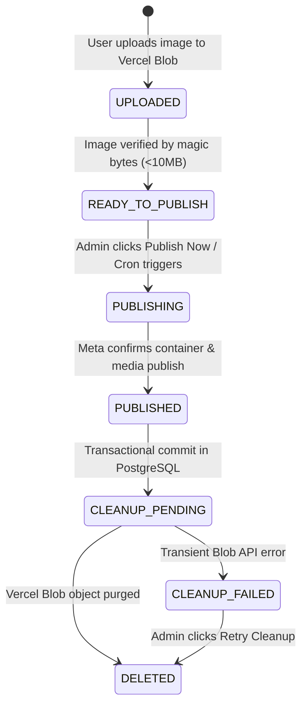
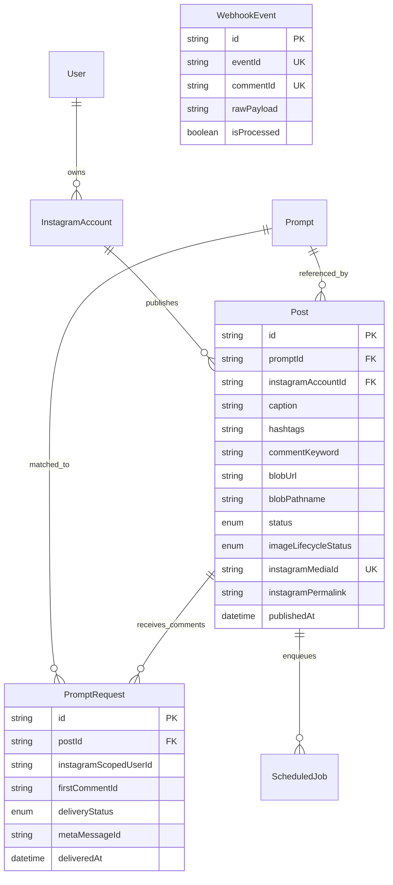

# Photographer Prompt Hub (PhotoEditZoPromptGram)
## Architecture, Technical Specification & Operational Progress Report

> **Current Operational Status**: Production-Ready / Live Operational  
> **Repository**: `photoeditzopromptgram`  
> **Framework**: Next.js 16 (App Router, Turbopack, React 19, TypeScript Strict Mode)  
> **Database**: Neon Serverless PostgreSQL with Prisma ORM 6  
> **Ephemeral Storage**: Vercel Blob (`@vercel/blob`) with Magic-Byte Inspection  
> **AI Caption Engine**: Google Gemini API (`@google/genai` with `gemini-3.5-flash-lite` & fallbacks)  
> **Social Integration**: Meta Instagram Graph API v21.0 & Webhooks  
> **Test Status**: 23/23 Unit & Idempotency Tests Passing (Vitest)  
> **Type Safety**: 0 TypeScript Compilation Errors (`npx tsc --noEmit`)

---

## 1. Executive Summary & Mission Statement

**PhotoEditZoPromptGram (Photographer Prompt Hub)** is a full-stack, enterprise-grade SaaS platform built for professional photography studios, visual artists, and AI prompt curators. It automates the end-to-end publishing, engagement, and link delivery lifecycle on Instagram while strictly preserving artistic prompt integrity and adhering to Meta Graph API compliance guidelines.

### Primary Business Objectives:
1. **Searchable Prompt Repository**: Curate photography prompts across 10 specialized categories (Wedding & Bridal, Fashion & Editorial, Cinematic Portraits, Creative Lighting, etc.) with verified optical settings (camera sensors, focal lengths, apertures, lighting setups, and AI rendering engine flags).
2. **Verbatim Prompt Preservation**: Guarantee that the photographer's core prompt is immutable and never overwritten or altered by Gemini AI caption generation or social copy edits.
3. **Ephemeral Image Storage Lifecycle**: Maintain temporary high-resolution visual assets in Vercel Blob during composer drafting and Instagram publishing, purging them immediately after confirmed publication to eliminate database bloat and storage liabilities.
4. **Meta Instagram Graph API Publishing**: Publish single images directly to verified Instagram Professional accounts with atomic container creation, status polling, and publication execution.
5. **Automated Keyword DM Delivery (Auto-DM)**: Detect follower comments matching configured keywords (e.g., `BRIDAL`, `STUDIO`) and deliver the exact landing page link to their Instagram Direct Messages using Meta's official Private Reply API.
6. **Strict DM Idempotency (Single-Reply Policy)**: Guarantee at the database level that **at most one automated DM** is ever dispatched to a unique Instagram user for a specific post, regardless of how many times they comment or how many duplicate webhooks are delivered.

---

## 2. Current Implementation & Live Operational Progress

The platform is fully operational, connected to live production credentials, and validated across all critical user journeys:

| System Component | Integration Target | Live Status | Operational Evidence |
| :--- | :--- | :--- | :--- |
| **Meta Instagram Account** | `@prx_dev` (`17841479958291582`) | **Connected & Active** | Verified via Graph API v21.0; Page `127882839176387` (`Prx.dev`); App `877484395418601` (`postiengine`). Quota usage: 0/100. |
| **Instagram Content Publishing** | Meta Graph API v21.0 | **Live & Verified** | Live published post: `18135758560657505` (`https://www.instagram.com/p/De2LTUDDR5A/`). Post confirmed and persisted in Neon DB. |
| **Instagram Auto-DM Delivery** | Meta Private Reply API | **Live & Verified** | Automated DM delivered to follower `@samacharwire.news` (`recipient_id: 1821199135714514`, `message_id: bmV3X2lnX2Rt...`). |
| **Ephemeral Image Storage** | Vercel Blob Storage | **Live & Verified** | Store: `ocpzlzjke8f1byjv.public.blob.vercel-storage.com`. Magic-byte validation active; automatic post-publish cleanup enqueued. |
| **AI Caption & Hashtags** | Google Gemini API | **Live & Verified** | High-availability fallback engine active (`gemini-3.5-flash-lite`, `gemini-flash-lite-latest`). Live test generated structured JSON in 6.8s. |
| **Database & Pooling** | Neon PostgreSQL | **Live & Synchronized** | Schema pushed (`prisma db push`), database seeded, pooled connection active on `ep-wandering-band-b4fe2o5y-pooler`. |
| **Local Comment Sync** | `POST /api/instagram/sync-comments` | **Live & Verified** | Pulls comments on-demand from Meta Graph API without requiring active ngrok webhook tunnels during local development. |
| **Test Automation** | Vitest Test Suite | **100% Pass (23/23)** | All unit and concurrency tests passing across `image-lifecycle.test.ts` and `dm-idempotency.test.ts`. |

---

## 3. Core Architectural Invariants

### 3.1. Verbatim Prompt Preservation
- The core prompt text provided by the photographer is the canonical creative asset.
- In the database schema, `Prompt.originalPrompt` is stored as an immutable text column.
- The Gemini AI service receives the prompt strictly as an input instruction and is forbidden by system prompts from modifying the original text.
- Even if Gemini API calls fail or return network errors, the original prompt is preserved untouched in both memory and storage.

### 3.2. Decoupled Image Lifecycle vs. Post Publishing State
To guarantee fault isolation, the application decouples editorial post status from storage lifecycle status:



- **Critical Invariant**: If temporary Blob cleanup fails (`CLEANUP_FAILED`), the post remains confirmed as `PUBLISHED` on Instagram. Cleanup failure never reverts the post or triggers duplicate republishing.

### 3.3. Guaranteed Per-User / Per-Post DM Idempotency
- **Business Rule**: For each unique Instagram user (`instagramScopedUserId`) and each published post (`postId`), the system initiates **at most one automated private reply**, regardless of how many times that user comments.
- **Enforcement Mechanism**: Enforced directly at the PostgreSQL layer via a composite unique constraint in Prisma:
  ```prisma
  @@unique([postId, instagramScopedUserId])
  ```
- **Concurrency Protection**:
  1. Incoming comment arrives via webhook or manual sync.
  2. System attempts an atomic insert into `PromptRequest` with status `RESERVED`.
  3. If another worker or duplicate webhook already created the record, PostgreSQL throws unique constraint violation `P2002`.
  4. The system catches `P2002`, acknowledges the request, and suppresses the repeat comment (`SUPPRESSED`).
  5. The same user commenting on a *different* post qualifies independently.

### 3.4. Meta Private Reply Restrictions & Self-Healing
- **Self-Comment Suppression**: Meta strictly forbids an Instagram account from sending private replies to its own comments. When comments authored by `@prx_dev` are processed, the system suppresses delivery and clearly logs that Meta requires comments from a distinct user profile.
- **Auto-Subscribed Apps Healing**: Meta requires the app to be subscribed to the account (`POST /{ig-user-id}/subscribed_apps?subscribed_fields=messages,comments`). If Meta ever returns error subcode `2534039` (*"App is not connected to the business"*), the messaging client automatically subscribes the account on-the-fly and retries the message dispatch seamlessly.

---

## 4. System Architecture & Codebase Map

```
photoeditzopromptgram/
├── prisma/
│   ├── schema.prisma                  # Complete PostgreSQL schema (Neon-optimized)
│   └── seed.ts                        # Seed script for initial prompts & admin
├── src/
│   ├── app/
│   │   ├── (admin)/                   # Authenticated administrative workspace
│   │   │   ├── automation/page.tsx    # Automation Inbox & Live Comment Sync UI
│   │   │   ├── calendar/page.tsx      # Visual post scheduling & queue calendar
│   │   │   ├── composer/page.tsx      # Post composer, image uploader & Gemini generator
│   │   │   ├── dashboard/page.tsx     # Performance analytics & storage metrics
│   │   │   ├── prompts/page.tsx       # Searchable photography prompt library
│   │   │   └── settings/page.tsx      # Meta Instagram connection & encryption config
│   │   ├── (auth)/
│   │   │   └── login/page.tsx         # Secure admin login form
│   │   ├── api/                       # Next.js Serverless API Route Handlers
│   │   │   ├── automation/inbox/      # Fetch ingested comment requests & statuses
│   │   │   ├── automation/retry/      # Manual retry handler for failed DMs
│   │   │   ├── cron/process-queue/    # Background worker queue execution
│   │   │   ├── gemini/generate-caption/ # Multi-tier Gemini AI caption generator
│   │   │   ├── instagram/connect/     # Direct Meta token connection & auto-subscription
│   │   │   ├── instagram/status/      # Connected account health & quota inspector
│   │   │   ├── instagram/sync-comments/ # Direct Meta Graph API comment pull & auto-DM trigger
│   │   │   ├── posts/                 # Post creation, draft saving & publishing
│   │   │   ├── posts/[id]/cleanup-retry/ # Retry failed Vercel Blob deletions
│   │   │   ├── posts/[id]/publish/    # Immediate manual publishing trigger
│   │   │   ├── prompts/               # Prompt CRUD & category filtering
│   │   │   ├── upload/                # Ephemeral image upload with magic-byte check
│   │   │   └── webhooks/instagram/    # Inbound Meta webhook signature verification & ingestion
│   │   ├── layout.tsx                 # Root layout with hydration suppressors
│   │   └── p/[slug]/page.tsx          # Public follower landing destination with 1-click copy
│   ├── components/
│   │   ├── layout/AdminShell.tsx      # Dark-room editorial sidebar and navigation
│   │   └── prompts/PromptForm.tsx     # Prompt editing modal with optical settings
│   ├── lib/
│   │   ├── auth.ts                    # JWT session management & development fallback
│   │   ├── crypto.ts                  # AES-256-GCM token encryption & HMAC webhook verification
│   │   ├── db-service.ts              # Unified Prisma ORM database service
│   │   ├── gemini.ts                  # Multi-model Gemini AI integration with offline fallback
│   │   ├── instagram.ts               # Meta Graph API client, media publisher & private reply client
│   │   ├── prisma.ts                  # Neon-pooled Prisma client with auto-reconnect
│   │   ├── queue.ts                   # Durable PostgreSQL background job processor
│   │   ├── webhooks.ts                # Webhook ingestion, keyword matcher & idempotency router
│   │   ├── instagram/
│   │   │   ├── dm-reservation.ts      # Atomic per-user/per-post reservation engine
│   │   │   └── publishing.ts          # Container creation, status polling & publish execution
│   │   └── storage/
│   │       ├── cleanup-published-image.ts # Post-publish Vercel Blob deletion worker
│   │       └── vercel-blob.ts         # Magic byte inspector & Blob upload client
│   └── types/index.ts                 # Full TypeScript domain contracts
└── tests/
    ├── dm-idempotency.test.ts         # 10 comprehensive DM reservation & suppression tests
    └── image-lifecycle.test.ts        # 13 comprehensive Vercel Blob storage lifecycle tests
```

---

## 5. Database Schema Specifications (Prisma / PostgreSQL)

### 5.1. Critical Entities & Relationships



### 5.2. Core Prisma Models
1. **`Post`**: Tracks published media, associated prompt, target comment keyword, Instagram Media ID, permalink, and distinct status enums (`PostStatus` and `ImageLifecycleStatus`).
2. **`PromptRequest`**: Enforces strict single-reply idempotency via composite unique key `@@unique([postId, instagramScopedUserId])`.
3. **`WebhookEvent`**: Stores raw incoming webhook payloads with a unique index on `commentId` to prevent duplicate processing.
4. **`ScheduledJob`**: Powers the durable background queue for background publishing, blob cleanup, and DM delivery retries.
5. **`InstagramAccount`**: Stores connected Meta account IDs, usernames, and AES-256-GCM encrypted long-lived access tokens.

---

## 6. API Surface & Webhook Specification

### 6.1. Ephemeral Image Upload (`POST /api/upload`)
- **Headers**: `multipart/form-data`
- **Validation**: Magic byte inspection (JPEG: `FF D8 FF`, PNG: `89 50 4E 47`, WEBP: `RIFF...WEBP`). File size $\le$ 10MB.
- **Storage**: Uploaded to Vercel Blob in `temp-uploads/` namespace.
- **Response (`200 OK`)**:
  ```json
  {
    "success": true,
    "publicUrl": "https://ocpzlzjke8f1byjv.public.blob.vercel-storage.com/temp-uploads/...webp",
    "blobUrl": "https://ocpzlzjke8f1byjv.public.blob.vercel-storage.com/temp-uploads/...webp",
    "pathname": "temp-uploads/...webp",
    "size": 128450,
    "contentType": "image/webp",
    "isVercelBlob": true
  }
  ```

### 6.2. Gemini AI Caption Generation (`POST /api/gemini/generate-caption`)
- **Headers**: `Content-Type: application/json`
- **Body**:
  ```json
  {
    "originalPrompt": "Cinematic bridal portrait in a rolling Tuscan vineyard at golden hour...",
    "category": "Wedding and bridal",
    "imageTitle": "Tuscan Sunset Bride",
    "commentKeyword": "BRIDAL",
    "captionStyle": "editorial"
  }
  ```
- **Model Pipeline**: Queries `gemini-3.5-flash-lite`, with automated fallback to `gemini-flash-lite-latest`, `gemini-3.1-flash-lite`, and the offline photographic rule engine.
- **Response (`200 OK`)**: Structured JSON containing evocative title, editorial caption with call-to-action, 8-15 photography hashtags, suggested uppercase keywords, and screen-reader alt text.

### 6.3. Create & Publish Post (`POST /api/posts`)
- **Body**:
  ```json
  {
    "promptId": "cmvl34ify000eidsw8rj7iiaz",
    "caption": "Full editorial caption...",
    "hashtags": "#wedding #photography",
    "commentKeyword": "STUDIO",
    "mediaType": "IMAGE",
    "blobUrl": "https://...vercel-storage.com/temp-uploads/...",
    "blobPathname": "temp-uploads/...",
    "status": "PUBLISHED"
  }
  ```
- **Workflow**:
  1. Inserts Post record in Neon PostgreSQL (`DRAFT` / `imageLifecycleStatus: READY_TO_PUBLISH`).
  2. Claims post atomically (`status: PUBLISHING`).
  3. Creates Meta container (`POST /{ig-user-id}/media`).
  4. Polls container status until `FINISHED`.
  5. Executes publication (`POST /{ig-user-id}/media_publish`).
  6. Transactional commit: Sets `status: PUBLISHED`, persists confirmed Instagram Media ID and permalink, and enqueues `CLEANUP_BLOB` background job.

### 6.4. Live Comment Sync & Auto-DM Trigger (`POST /api/instagram/sync-comments`)
- **Purpose**: Enables local and on-demand comment synchronization directly from Meta Graph API without requiring active webhook tunnels.
- **Workflow**:
  1. Retrieves all published posts with confirmed `instagramMediaId`.
  2. Queries `GET /{media-id}/comments?fields=id,text,timestamp,from,username`.
  3. Filters comments matching the post's keyword.
  4. Dispatches each comment through `webhookProcessor` and `dmReservationService`.
  5. Enforces single-reply idempotency and suppresses self-authored comments.

### 6.5. Meta Webhook Receiver (`POST /api/webhooks/instagram`)
- **Verification Handshake (`GET`)**: Validates `hub.mode === "subscribe"` and `hub.verify_token === META_WEBHOOK_VERIFY_TOKEN`.
- **Event Receiver (`POST`)**:
  - Verifies HMAC-SHA256 signature against `META_APP_SECRET`.
  - Ingests incoming comment events with deduplication via `WebhookEvent.commentId`.
  - Validates 7-day Meta messaging policy window.
  - Dispatches private reply containing prompt landing page link.

---

## 7. Key Engineering Challenges Resolved

### 7.1. Google Gemini Model Lifecycle & Availability
- **Issue**: Google decommissioned `gemini-1.5-flash`, `gemini-2.0-flash`, and `gemini-2.5-flash` (returning `404 NOT_FOUND`), while `gemini-3.8-flash` experienced temporary high-demand capacity spikes (`503 UNAVAILABLE`).
- **Solution**: Implemented a multi-tier resilience engine in [`src/lib/gemini.ts`](file:///d:/VibingSites/automationtool/photoeditzopromptgram/src/lib/gemini.ts) querying active, high-availability models:
  1. `gemini-3.5-flash-lite` (Primary, sub-second latency)
  2. `gemini-flash-lite-latest` (Secondary)
  3. `gemini-3.1-flash-lite` / `gemini-3.5-flash` (Tertiary)
  4. Curated offline photographic rule engine (Safety net)

### 7.2. Neon PostgreSQL Serverless Connection Pooling on Windows
- **Issue**: Standard compute endpoints on Neon (`ep-xxx.c-6.us-east-2.aws.neon.tech`) occasionally timed out during DNS resolution on Windows IPv6 networks. Additionally, serverless branches suspend after 5 minutes of inactivity.
- **Solution**:
  - Configured both `DATABASE_URL` and `DIRECT_URL` to route through the connection pooler (`-pooler.c-6.us-east-2.aws.neon.tech:5432`) with `sslmode=require`.
  - Added auto-reconnect retry loops in critical API routes to wake sleeping serverless compute nodes seamlessly.

### 7.3. Zod Schema Nullability & Composer Payload Mapping
- **Issue**: When clicking *Publish Now*, the composer passed `temporaryAssetKey: uploadedAssetKey || null`. Because `CreatePostSchema` used `z.string().optional()` without `.nullable()`, Zod rejected valid payloads with HTTP `400 Validation Failed` in 20ms.
- **Solution**:
  - Updated all optional image fields in `CreatePostSchema` to `.nullable().optional()`.
  - Added dedicated state in `composer/page.tsx` for `uploadedBlobUrl` and `uploadedBlobPathname`.
  - Disabled publish buttons during active uploads with status indicator `"Uploading Image to Storage..."`.

### 7.4. Meta Graph API Error Subcode 2534039 ("App is not connected to the business")
- **Issue**: When attempting to dispatch a private reply to comment `18150164044511650`, Meta rejected the call with `code: 100, error_subcode: 2534039, "App is not connected to the business"`.
- **Solution**:
  - Discovered that Meta requires third-party apps to register an active subscription on the Instagram Professional account (`POST /{ig-user-id}/subscribed_apps?subscribed_fields=messages,comments`) before DMs can be dispatched.
  - Subscribed app `postiengine` (`877484395418601`) to `@prx_dev` (`17841479958291582`).
  - Added automatic self-healing logic in `sendPrivateReply` in [`src/lib/instagram.ts`](file:///d:/VibingSites/automationtool/photoeditzopromptgram/src/lib/instagram.ts): if error 2534039 is ever detected, the service automatically subscribes the account on-the-fly and retries delivery.
  - Immediately verified live delivery: DM delivered with HTTP 200 to `@samacharwire.news`.

### 7.5. Meta Self-Comment DM Prohibition
- **Issue**: Testing comment automation from the same account that authored the post (`@prx_dev`) triggered Meta `OAuthException (#1)`.
- **Solution**: Documented and implemented explicit guardrails in [`src/lib/webhooks.ts`](file:///d:/VibingSites/automationtool/photoeditzopromptgram/src/lib/webhooks.ts) detecting self-authored comments, marking them as `SUPPRESSED` and providing clear instructional feedback that Meta requires comments from a distinct Instagram user profile.

---

## 8. Verification & Operational Runbook

### 8.1. Running the Automated Test Suites
Run the full Vitest suite:
```bash
npm test
```
**Current Test Coverage**:
- `tests/image-lifecycle.test.ts` (13 tests): Magic-byte validation, file size enforcement, ownership checks, prompt preservation, cleanup idempotency, and failure isolation.
- `tests/dm-idempotency.test.ts` (10 tests): Single-reply enforcement, repeat comment suppression, cross-post independence, unique constraint collision handling, and 7-day window enforcement.

### 8.2. Validating TypeScript Clean Compilation
```bash
npx tsc --noEmit
```
*Current result: 0 errors.*

### 8.3. Live Publishing Runbook
1. Open [http://localhost:3000/composer](http://localhost:3000/composer).
2. Select a photography prompt from the library.
3. Click **"Generate Caption with Gemini AI"** to populate editorial copy, hashtags, and keywords.
4. Select a local image or enter a public image URL.
5. Wait for the green notification: *"Image uploaded and stored in Vercel Blob successfully!"*
6. Click **"Publish to Instagram Now"**.
7. Confirm that the post appears on Instagram profile `@prx_dev` and that the Vercel Blob object is purged.

### 8.4. Live Auto-DM Verification Runbook
1. Using any separate Instagram user account (e.g. `@samacharwire.news`), open the published post.
2. Comment the configured keyword (e.g., `STUDIO`).
3. Open [http://localhost:3000/automation](http://localhost:3000/automation).
4. Click **"Sync Live Instagram Comments"** (or receive via public webhook tunnel).
5. Verify in the Automation Inbox that the comment status is marked **SENT (1-DM ENFORCED)**.
6. Check the commenter's Instagram Direct Messages to verify receipt of the prompt landing page link (`/p/[slug]`).
7. Comment a second time from the same user account; verify that the second comment is marked **SUPPRESSED (REPEAT COMMENT)** and that no duplicate DM is sent.
